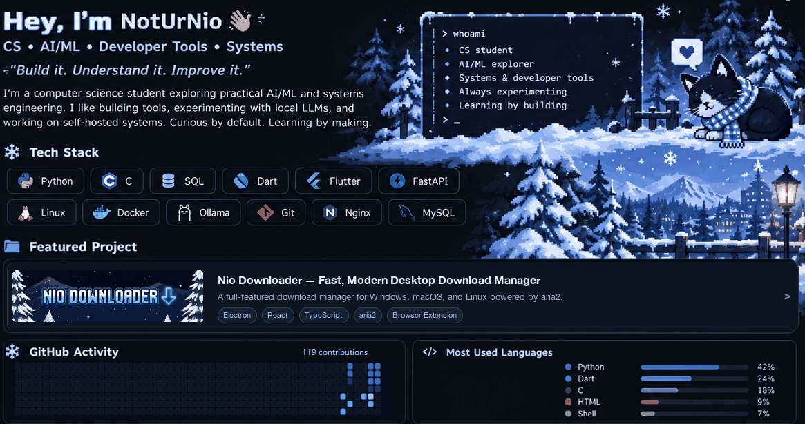

  

  

  <a href="https://github.com/NotUrNio/Nio-Downloader"><b>🚀 Nio Downloader</b></a> &nbsp;•&nbsp;
  <a href="https://github.com/NotUrNio/Nio-Downloader-Browser-Extension"><b>🧩 Browser Extension</b></a> &nbsp;•&nbsp;
  <a href="https://github.com/NotUrNio/ULPF"><b>🛡️ ULPF</b></a> &nbsp;•&nbsp;
  <a href="https://github.com/NotUrNio?tab=repositories"><b>📦 All Repositories</b></a> &nbsp;•&nbsp;
  <a href="mailto:niowork477@gmail.com"><b>📫 Email Me</b></a>

 

### ❄️ Featured Projects

| Project | Description | Stack | Links |
| :--- | :--- | :--- | :---: |
| **[Nio Downloader](https://github.com/NotUrNio/Nio-Downloader)** | Fast, modern cross-platform download manager powered by aria2 | `Electron` `React` `TypeScript` `aria2` | [Releases](https://github.com/NotUrNio/Nio-Downloader/releases) |
| **[Nio Extension](https://github.com/NotUrNio/Nio-Downloader-Browser-Extension)** | Companion browser extension for Chrome, Firefox, Edge & Safari | `WXT` `React` `Vite` `TypeScript` | [Releases](https://github.com/NotUrNio/Nio-Downloader-Browser-Extension/releases) |
| **[ULPF](https://github.com/NotUrNio/ULPF)** | Universal Log Processing Framework with local dashboard | `Python` `FastAPI` `SQLite` | [Repository](https://github.com/NotUrNio/ULPF) |

